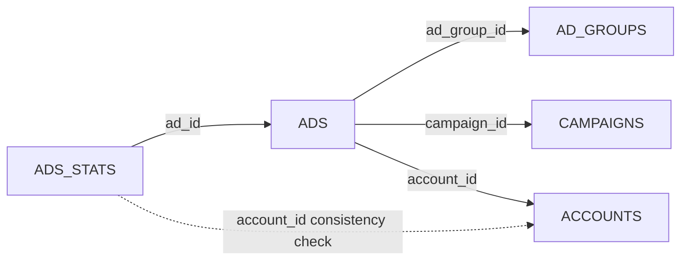
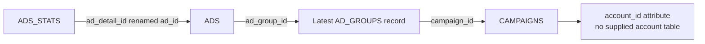
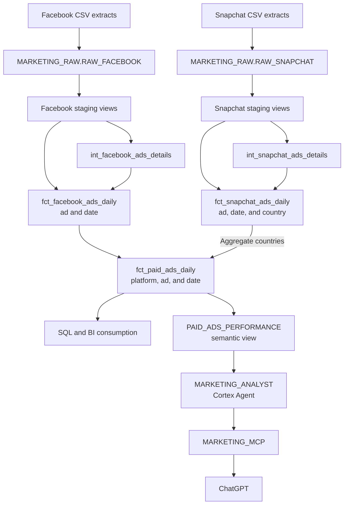
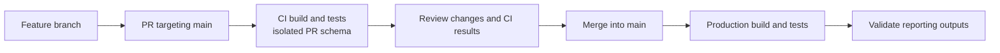

# Marketing Analytics Platform

### From separate advertising extracts to a governed reporting product

**Snowflake · dbt Fusion · GitHub Actions · Elementary · Cortex · MCP**

A unified Facebook and Snapchat reporting platform built for a simulated internal marketing client. The project combines SQL transformation, analytical modeling, automated data-quality checks, environment isolation, secure deployment, and natural-language reporting.

| Engagement | Delivery |
| --- | --- |
| **Client scenario** | An internal marketing department needs a reusable view of advertising activity across platforms. |
| **Engineering scope** | Source exploration, warehouse setup, models, tests, CI/CD, observability, reporting access, and documentation. |
| **Reporting grain** | One platform, one ad, one reporting date. |
| **Validated baseline** | 93,352 unified daily records; spend reconciled by platform and currency. |
| **Consumption** | SQL and a tested ChatGPT connection through a Cortex Agent and managed MCP. |
| **Platform adaptation** | Snowflake implementation of a Databricks-based brief. |

> **How to read this README:** the summaries describe the solution; click the arrows to expand datasets, implementation details, decisions, and operating procedures. All project explanations are included in this file.

**Navigate:** [Business requirements](#business-requirements) · [Source datasets](#source-datasets) · [Architecture](#architecture) · [Modeling](#modeling-decisions) · [Metrics](#metric-definitions) · [Quality](#data-quality-and-validation) · [Security](#security-and-environments) · [Delivery](#cicd-and-local-setup) · [Operations](#monitoring-and-operations) · [AI reporting](#semantic-reporting-and-mcp) · [Delivery status](#delivery-status-and-limitations)

## Business requirements

The marketing department runs campaigns on Facebook and Snapchat. To assess performance, marketers visit each platform separately and sometimes combine exports in Excel. Different structures and naming conventions make analysis repetitive and difficult to reuse. Other teams lack a centralized dataset with documented definitions, lineage, and automated quality checks.

The requirement is a reusable marketing data product that gives technical and non-technical users a consistent way to analyze spend, impressions, clicks, and campaign performance over time.

| Business question | Reporting capability |
| --- | --- |
| How much did we spend on each platform or campaign? | Aggregate spend by platform, campaign, period, and currency. |
| Which platforms and campaigns generated the most impressions and clicks? | Rank aggregate activity using platform-qualified campaign IDs. |
| What are CPC, CPM, and CTR? | Calculate ratios from aggregated measures with zero-denominator handling. |
| How does campaign performance change over time? | Analyze daily activity using reporting dates. |
| How do Facebook and Snapchat compare? | Use a common model while respecting currency and date coverage. |

These capabilities support performance reviews and investigation of delivery and cost efficiency. They do not establish profitability. For example, £100 spend and 200 clicks gives a CPC of £0.50 whether those clicks produce no purchases or profitable sales. Identifying profitable campaigns requires attributed revenue and the associated business costs, which are absent from these inputs.

<details>
<summary><strong>Delivered capabilities</strong></summary>

- A reporting fact at **platform, ad, and reporting date** grain.
- Reusable staging and ad-details models supporting platform-specific facts.
- Explicit rules for missing counts, currencies, ratios, and historical metadata.
- Automated dbt validation in isolated PR schemas and production deployment through GitHub Actions.
- Dedicated CI, production, and reporting identities.
- Elementary reports for transformation health and performance.
- A semantic view and Cortex Agent accessible through ChatGPT using MCP and OAuth.

The result is a data foundation for SQL, BI tools, and AI reporting. A BI dashboard is not part of the delivered scope.

</details>

## Source datasets

The inputs are **nine CSV extracts: five Facebook files and four Snapchat files**. They separate descriptive entities from recorded activity:

| Input | What a row represents | Purpose |
| --- | --- | --- |
| Facebook accounts | An advertising account | Supplies account labels and currency; an account is not necessarily one company. |
| Facebook campaigns and ad groups | A campaign or ad group | Supplies names and update timestamps. |
| Facebook ads | An ad with account, campaign, and ad-group references | Connects the separate entity files. |
| Facebook statistics | One ad on one reporting date | Supplies spend, impressions, clicks, and an account reference. |
| Snapchat campaigns | A campaign with an account reference | Supplies campaign labels and account association. |
| Snapchat ad groups | An ad-group record, potentially one of several versions | Connects ad groups to campaigns and provides an update timestamp. |
| Snapchat ads | An ad with an ad-group reference | Connects daily performance to the hierarchy. |
| Snapchat statistics | One ad on one reporting date in one country | Supplies measures, currency, and country. |

Facebook ads point directly to accounts, campaigns, and ad groups. Snapchat follows **ad → ad group → campaign → account ID**, with no separate Snapchat account table. Snapchat currency comes directly from statistics; Facebook currency comes from accounts. The implementation does not match accounts across platforms.

An ad-details row describes an advertisement; it does not record daily performance. The same ad can appear on many reporting dates, and Snapchat can have several country records for one date. These distinctions determine the joins, tests, and aggregation required before combining sources.

The transformation standardizes column names and types, converts text `null` values into SQL NULL, enriches statistics with entity IDs, resolves current ad-group versions where necessary, and aggregates Snapchat countries to daily ad totals. Platform facts retain source missingness; the unified model applies the agreed zero-count reporting convention.

<details>
<summary><strong>Explore all nine files, their relationships, field mappings, and a worked example</strong></summary>

### What was supplied

The inputs are nine CSV extracts: five for Facebook and four for Snapchat. They contain two different kinds of information:

- **Entity details** describe accounts, campaigns, ad groups, and ads. They answer which ad a record refers to and which entities it belongs to.
- **Performance statistics** record spend, impressions, and clicks for an ad on a reporting date. Snapchat also distinguishes country.

An ads file is therefore not a record of daily performance. An ad can exist in the details data without appearing in the supplied statistics. Conversely, each ad can occur on many dates in the statistics without being a duplicate.

The field inventory below describes the columns consumed by the checked-in models. It is not an exhaustive schema dump of every original CSV. Historical counts come from recorded validation rather than a new data load.

### Business entities

| Entity | Meaning in this dataset | How it is used |
| --- | --- | --- |
| Account | An advertising account identified by the source platform. It is not automatically a distinct company. | Associates activity with an account; Facebook account data also supplies currency. |
| Campaign | A platform campaign containing advertising activity. Matching names across platforms do not prove a common business campaign. | Groups spend and activity for campaign reporting. |
| Ad group | A grouping of ads; Snapchat's extract supplies its campaign reference. | Connects ads to campaign details and supports ad-group analysis. |
| Ad | An individual advertisement identified within its platform. | Connects descriptive metadata to performance records. |
| Statistics | Recorded activity for an ad and reporting date, with country on Snapchat. | Supplies the additive measures used in facts and reports. |

Impressions represent recorded displays and clicks represent recorded click activity. The exact platform click definitions and Snapchat geographic attribution remain source-contract questions; standardizing column names does not prove that all underlying event definitions are identical.

### Facebook: five files

All five sources are registered under `MARKETING_RAW.RAW_FACEBOOK`.

| File → raw table | Row meaning | Consumed fields and purpose |
| --- | --- | --- |
| `new_acccount_de_randomized.csv` → `ACCOUNTS` | One account in the expected staging contract. | `account_id`, `account_name`, `ad_currency_code`, `account_created_at`, `account_updated_at`: account identity, currency, and metadata. |
| `new_campaign_de_randomized.csv` → `CAMPAIGNS` | One campaign in the expected staging contract. | `campaign_id`, `campaign_name`, `campaign_updated_at`: campaign descriptions. No account reference is consumed from this file. |
| `new_adgroup_de_randomized.csv` → `AD_GROUPS` | One ad group in the expected staging contract. | `ad_group_id`, `ad_group_name`, `ad_group_updated_at`: ad-group descriptions. No campaign reference is consumed from this file. |
| `new_ads_de_randomized.csv` → `ADS` | One ad in the expected staging contract. | `ad_id`, `account_id`, `campaign_id`, `ad_group_id`, `ad_name`, `ad_status`, `ad_updated_at`: connects each ad directly to the other three entities. |
| `ads_stats.csv` → `ADS_STATS` | One ad on one reporting date. | `ad_id`, `account_id`, `ad_date`, `ad_spend`, `ad_impressions`, `ad_clicks`: performance measures and identifiers. |

### How the Facebook files connect



The implementation uses the foreign keys in ADS directly. It does not invent an ad-group-to-campaign key that is absent from the consumed ad-group fields. The stats account ID is retained in the Facebook fact; a separate test checks that it agrees with the account assigned to the ad.

Currency is obtained through ADS → ACCOUNTS. It is not read from Facebook statistics. Missing metadata can therefore affect currency enrichment even if the original performance record exists.

### Snapchat: four files

All four sources are registered under `MARKETING_RAW.RAW_SNAPCHAT`.

| File → raw table | Row meaning | Consumed fields and purpose |
| --- | --- | --- |
| `snapchat_ads_campaign_history_new_campaign_names.csv` → `CAMPAIGNS` | One campaign in the expected staging contract. | `campaign_id`, `account_id`, `campaign_name`: campaign identity and account association. |
| `snapchat_ads_adgroup_history_new_ad_group_names.csv` → `AD_GROUPS` | An ad-group source record; multiple versions of an ID are permitted. | `_surrogate_key`, `ad_group_id`, `campaign_id`, `ad_group_name`, `ad_group_updated_at`: version identifier, campaign relationship, and update time. |
| `snapchat_ads_ad_history_new_ad_names.csv` → `ADS` | One ad in the expected staging contract. | `ad_id`, `ad_group_id`, `ad_name`, `ad_detail_updated_at`: ad identity and its ad-group reference. |
| `snapchat_ads_stats.csv` → `ADS_STATS` | One ad on one reporting date in one country, subject to the fact-grain check. | `ad_detail_id`, `ad_date`, `ad_currency_code`, `ad_country`, `ad_spend`, `ad_impressions`, `ad_clicks`, `data_src`: activity, currency, geography, and source label. |

### How the Snapchat files connect



The intermediate model selects the latest ad-group version using `ad_group_updated_at`. It joins ads and campaigns directly; it does not apply latest-record selection to all three Snapchat entities. Staging requires unique ad IDs and campaign IDs, but does not require unique ad-group IDs because those records can be versioned.

There is no Snapchat account file in this input set. The model takes `account_id` from campaigns and currency from each statistics record. It does not join Snapchat account IDs to Facebook accounts. This avoids assuming the two platforms share an identifier namespace.

The source surrogate key is retained in staging as `source_surrogate_key`. It is not used as the unified fact key or as the latest-record tie-breaker.

### Source differences and what changed

| Difference or issue | Transformation | Why |
| --- | --- | --- |
| Snapchat statistics use `ad_detail_id`; Facebook uses `ad_id`. | Rename the Snapchat identifier to `ad_id`. | Provide the same join and reporting field name. |
| Both sources use fields such as `ad_date`, `ad_spend`, and `ad_clicks`. | Standardize to `reporting_date`, `spend`, `impressions`, and `clicks`. | Consumers use one vocabulary. |
| IDs may arrive as numeric-looking values. | Cast identifiers to VARCHAR. | Preserve identifier semantics rather than treating them as quantities. |
| Facebook spend has two decimal places; Snapchat preserves six. | Cast Facebook spend to `NUMBER(38,2)` and Snapchat spend to `NUMBER(18,6)` in staging. | Retain the precision used by each source; do not round Snapchat to match Facebook. |
| Some count fields contain text `'null'`. | Trim, lowercase, convert that literal to SQL NULL, then cast to a numeric type. | Prevent numeric-conversion errors without interpreting missing data as zero at source level. |
| Snapchat ad-group IDs can have multiple versions. | Preserve versions in staging and select the latest in intermediate. | Resolve the reusable current ad details at a defined grain. |
| Snapchat has country rows; Facebook does not. | Preserve country in the Snapchat fact, then sum countries for unified reporting. | Match daily ad grain without silently dropping records. |
| Missing counts remain in platform facts. | Coalesce impressions and clicks to zero in the unified transformation. | Apply the agreed reporting assumption while retaining upstream evidence. |
| Different currencies occur. | Carry `currency_code` through facts and reporting. | Prevent unsupported currency addition. |

### What a performance row means

Illustrative example only—not a result from the supplied files:

| Platform | Ad | Date | Country | Spend | Impressions | Clicks |
| --- | --- | --- | --- | ---: | ---: | ---: |
| Snapchat | S1 | 2025-01-01 | DE | 10 EUR | 1,000 | 20 |
| Snapchat | S1 | 2025-01-01 | AT | 5 EUR | 500 | 10 |

These are two valid country-level records, not duplicate daily activity. The Snapchat fact retains both. The unified model produces one daily record for S1 with 15 EUR spend, 1,500 impressions, and 30 clicks, assuming its other reporting attributes agree. A similarly named Facebook ad remains a separate platform record.

If one country row's clicks are missing, the selected reporting rule treats that missing count as zero. The resulting total is a reporting assumption, not evidence that the source recorded no clicks.

### Observations that affected the design

- The recorded baseline has 92,300 Facebook fact rows and 2,809 Snapchat country-level fact rows. Aggregation reduces Snapchat to 1,052 unified daily rows, giving 93,352 unified records overall.
- Facebook reporting dates cover 2025, while Snapchat's supplied statistics cover 2024. Cross-platform comparisons must disclose this rather than silently substitute periods.
- An earlier investigation identified 304 Snapchat ads referencing absent ad-group records. They were outside the supplied statistics subset. In the inspected repository, the staging relationship test for this reference is commented out, while the Snapchat fact's ad-group relationship test is active.
- Entity files and statistics do not have identical coverage. An ad without statistics should not be assigned zero daily activity for dates where no statistics record was supplied.
- Update timestamps describe entity metadata changes. They do not establish when a CSV was loaded into the warehouse.

</details>

## Architecture



Raw extracts are loaded manually; dbt manages transformations. The diagram does not imply automated API ingestion. Stakeholder requests travel from ChatGPT through MCP to the agent and its query tools.

| Component | Implementation | Purpose |
| --- | --- | --- |
| Warehouse | Snowflake | Store data, isolate environments, execute SQL, and govern access. |
| Transformation | dbt Fusion CLI 2.0.6 and VS Code extension | Version-controlled models, dependencies, and tests. |
| Reusable operations | dbt packages, including dbt_utils | Reuse common transformations while retaining explicit business logic. |
| Delivery | GitHub Actions | Validate PRs and deploy changes reaching main. |
| Observability | Elementary | Inspect execution history and test results. |
| Semantic reporting | Snowflake semantic view and Cortex Agent | Define approved metrics for natural-language queries. |
| Stakeholder interface | ChatGPT through managed MCP and OAuth | Query reporting through a restricted identity. |

The original brief specifies Databricks and a Service Principal. This implementation preserves its intent using Snowflake databases, roles, and service users with key pairs. It is an explicit platform adaptation, not an implementation of Unity Catalog.

## Modeling decisions

The models separate source cleanup, reusable entity enrichment, platform performance, and unified reporting. Grain and business meaning determine the joins and aggregations.

<details>
<summary><strong>Read the modeling choices and their consequences</strong></summary>

### Preserve source grain before unifying platforms

Facebook statistics are daily ad records. Snapchat statistics include country, so the same ad can legitimately appear more than once on a reporting date.

| Model | Grain | Materialization |
| --- | --- | --- |
| Platform staging models | Source entity or statistics grain | View |
| `int_facebook_ads_details` | One current details record per ad | Table |
| `int_snapchat_ads_details` | One current details record per ad | Table |
| `fct_facebook_ads_daily` | Ad and reporting date | Table |
| `fct_snapchat_ads_daily` | Ad, reporting date, and country | Table |
| `fct_paid_ads_daily` | Platform, ad, and reporting date | Table |

Removing country from Snapchat's selected columns would not remove its underlying granularity. The platform fact therefore retains country, and the unified transformation aggregates across it before combining platforms.

Platform is part of the unified identity because each source has its own ID namespace. `ad_id` alone is not a cross-platform key, and a daily fact also needs `reporting_date` to be unique.

### Reuse enrichment and protect measures from duplication

Intermediate models connect ads to their ad-group, campaign, and available account information. Left joins preserve driving records and expose missing metadata. Unique parent keys protect joins against row multiplication and inflated spend.

IDs use strings because they identify records rather than represent quantities. Facts retain identifiers while descriptive fields remain in the details layer. Separate campaign, account, and ad-group dimensions were not required for the initial reporting scope; they become useful when shared entity reporting or historical attribute management warrants them.

### Distinguish current metadata from historical activity

Facebook details select the latest records for ads, ad groups, campaigns, and accounts. Snapchat selects the latest ad-group version and joins its ads and campaigns directly, relying on their staging uniqueness contracts. Statistics retain historical reporting dates, but joined attributes reflect current metadata at rebuild time.

This is **current-detail reporting over historical activity**, not date-effective historical attribution. If an association changes while an entity retains its ID, historical grouping could change after rebuilding. Platform behavior and the required attribution policy must be confirmed before introducing snapshots or effective-date joins.

Latest selection does not override staging uniqueness tests. Versioned ingestion would require an intentional revision to staging grain and tests, including a resolution rule for conflicting versions with equal timestamps.

### Make reporting assumptions explicit

| Topic | Decision | Reason and consequence |
| --- | --- | --- |
| Missing clicks and impressions | Keep NULL upstream; use zero in unified reporting. | Preserve source-quality visibility while applying the selected reporting convention. Missing is not proven zero and may understate activity. |
| Missing spend | Do not automatically replace it with zero. | A missing monetary amount should not silently become no spend. SUM ignores NULL, so completeness still needs checking. |
| Currency | Separate monetary results by source currency. | No approved FX dataset or conversion policy exists. |
| Ratios | Divide aggregate components; return NULL for zero denominators. | Avoid misleading averages of row-level ratios and undefined results. |
| Ad status | Retain historical statistics for inactive ads. | Paused, archived, or deleted ads can have valid past activity. |
| Geography | Retain Snapchat country detail in its fact and aggregate for unification. | Account location cannot substitute for ad-delivery geography. |

### Select materializations from evidence

Views keep staging standardization lightweight. Intermediate and mart tables materialize reusable results for downstream queries. The recorded production unified fact contained **93,352 rows**, occupied approximately **1.29 MiB**, and had a latest recorded execution time of **1.0 second**.

Those observations do not justify incremental complexity yet. Incremental processing is deferred until growth, build cost, or refresh needs establish a reason and the handling of updates, late arrivals, and deletes is defined. Only two production execution samples per model were visible in the recorded report: this is a baseline, not a performance trend.

</details>

<details>
<summary><strong>Implementation details: staging, latest records, timestamps, facts, and dimensions</strong></summary>

### Staging: make each source usable

Staging models reference registered dbt sources and standardize column names and types. They are materialized as views.

- IDs use `VARCHAR`: they identify entities and are not measures to calculate with.
- Date and timestamp fields are converted to their relevant types.
- Numeric measures use numeric types appropriate to their values. Precision and scale are technical constraints that should reflect source requirements, rather than arbitrary business rounding.
- Literal text such as `'null'` must be handled as missing data before numeric conversion where present. This differs from a genuine SQL `NULL`.
- Original missing click and impression values are preserved for source-level investigation.
- Ad status remains available; historical statistics are not discarded because an ad is paused, archived, or deleted.

`CAST` validates whether a value can be converted; it does not prove that the resulting value is correct in business terms. Replacing failed conversions with `TRY_CAST` would require an explicit policy so invalid values do not silently become missing data.

Source declarations identify existing warehouse objects. They do not upload the CSV files.

### Intermediate: build reusable ad details

`int_facebook_ads_details` and `int_snapchat_ads_details` prepare one current details record per ad for downstream facts. They are materialized as tables.

For Facebook, ads supply account, campaign, and ad-group IDs. The intermediate model joins each ID to its corresponding staging entity.

For Snapchat, ads join to the latest ad-group record, which supplies campaign_id. Campaigns supply account_id. There is no separate account table and no join to Facebook accounts. Currency is supplied directly by Snapchat statistics and carried into the fact.

The latest-record pattern uses:

```sql
qualify row_number() over (
    partition by ad_id
    order by ad_updated_at desc
) = 1
```

Facebook applies this selection independently to ads, ad groups, campaigns, and accounts. Snapchat applies it only to ad groups; its ads and campaigns are joined directly. Two different entities updating on the same day is not a conflict. Two versions of the same entity with equal ordering timestamps can be ambiguous if their contents differ.

Where staging tests require unique entity IDs, latest selection is effectively a no-op on valid inputs. It does not make duplicate staging records acceptable or replace those tests. Introducing versioned ingestion later requires revisiting staging grain, keys, and tie-breaking as one design change.

The Facebook details model retains the ad's source update timestamp and derives a combined detail-update timestamp from the joined entities. These mean different things: the former describes the ad record; the latter indicates the latest contributing source update. Neither is a warehouse ingestion timestamp or a historical validity interval. With ordinary `GREATEST`, a missing contributing timestamp can produce a missing combined result; timestamp tests and missing-parent behavior must be considered together.

### Facts: attach performance to reporting identifiers

| Model | Grain | Purpose |
| --- | --- | --- |
| `fct_facebook_ads_daily` | Ad and reporting date | Facebook performance with reporting IDs. |
| `fct_snapchat_ads_daily` | Ad, reporting date, and country | Snapchat performance at its source geographic grain. |
| `fct_paid_ads_daily` | Platform, ad, and reporting date | Unified performance across both sources. |

Platform facts join daily statistics to the intermediate details. A left join retains statistics even when matching metadata is unavailable; missing metadata should be visible through tests and investigation.

The unified model aggregates Snapchat's country records to daily ad totals, then combines compatible platform records using union semantics. `dbt_utils.union_relations` was evaluated for reusable column alignment. The macro can align relation columns and types, but it cannot decide grain, resolve missing business fields, or establish correct aggregations. The inspected implementation uses explicit `UNION ALL`. dbt_utils is used for the unified compound-key test, not for this union.

`UNION ALL` appends rows; it does not match Facebook ads to Snapchat ads. The platform column distinguishes each source's identifier namespace. A daily unique key therefore includes the reporting date as well as platform and ad ID.

Country remains available in the Snapchat fact but is not part of the unified daily grain. Facebook account geography, if available, would describe an account and cannot automatically substitute for the geography of ad delivery.

Names were deliberately omitted from the daily facts in favor of identifiers. Details models retain descriptive fields. The first semantic-view version reports campaigns by ID; it must not invent campaign names.

### Current details versus historical activity

Reporting dates and statistics describe historical activity. The joined ad details describe the latest available metadata at build time. The current implementation does not join details using effective-from and effective-to dates.

Consequently, a later correction or parent reassignment in supplied metadata could change how old performance is grouped after a rebuild. This is a consequence of the design, not a claim that either platform permits moving an existing ad between parents while retaining its ID.

Whether parent changes are possible and whether the business needs date-effective attribution remain open questions. Snapshots or historical dimensions should be introduced only with a defined ingestion and reporting requirement. A surrogate key alone does not reconstruct missing historical versions.

### Why not separate every entity into a dimension?

The first reporting requirement is daily performance, supported by reusable enriched ad details. Separate `dim_campaign`, `dim_ad_group`, and `dim_account` models were not required to achieve that initial result.

Separate dimensions become useful when multiple facts reuse the same entities, analysts need independent entity exploration, descriptive attributes need a shared contract, or historical attribute tracking is required. Their absence is a deliberate scope decision, not a claim that dimensional modeling is unnecessary.

</details>

<details>
<summary><strong>Engineering decision register: rationale, trade-offs, and revisit conditions</strong></summary>

| Decision | Rationale | Trade-off or revisit condition |
| --- | --- | --- |
| Snowflake adaptation of the Databricks-based brief | Implement the brief's architectural intent in the selected warehouse. | Snowflake identities and configuration must replace platform-specific instructions explicitly. |
| Understand source grain before implementation | Prevent incorrect joins and aggregation. | New ingestion contracts require another grain review. |
| Shared raw database | One source location across environments. | Raw changes are shared; CI is not source-snapshot isolated. |
| Distinct development, CI, and production outputs | Protect published data from experiments. | Grants, profiles, and schema cleanup need maintenance. |
| Dedicated CI/CD identities | Automation is independent of personal credentials. | Manage key rotation and separate secrets. |
| String IDs | Preserve identifier semantics and avoid arithmetic assumptions. | Include platform when combining identifier namespaces. |
| Latest ad details | Produce one reusable current record per ad. | Historical attribution and tied versions need explicit future design. |
| Left joins for enrichment | Preserve performance records and expose missing metadata. | Missing relationships remain visible and need investigation. |
| Keep Snapchat country grain in its fact | Respect the actual source grain. | Aggregate it before combining with Facebook daily data. |
| Zero-fill missing counts only in unified reporting | Apply the agreed business assumption at the consumption layer. | Missing is not proven zero; counts and ratios may be affected. |
| Preserve spend and separate currencies | Avoid unsupported monetary assumptions. | Combined currency reporting requires an approved FX process. |
| IDs in facts, descriptions in details | Keep the initial fact focused on measures and identifiers. | Add supported name access when analysts need it. |
| Full rebuilds for current tables | Small data and short observed builds favor simplicity. | Reassess with growth, cost, latency, and change-handling evidence. |
| Elementary per environment | Separate operational evidence by environment. | Reports still need a refresh and review process. |
| Semantic view plus agent exposed through MCP | Centralize business definitions for natural-language reporting. | Evaluate generated answers; instructions alone are not guarantees. |
| Separate reporting login | Demonstrate restricted stakeholder access without changing the developer's defaults. | Real teams should use individual identities and avoid shared passwords. |
| Keep ingestion freshness pending | No reliable load metadata exists in the supplied extracts. | Add ingestion timestamps and an expected delivery schedule first. |

### Decision ownership and change control

Reporting assumptions are part of the data product contract. A change to missing-value policy, grain, currency conversion, or historical attribution should be reviewed with affected consumers, reflected in tests and semantic definitions, and validated against representative queries before release.

Technical changes should have evidence proportionate to their impact. For example, incremental materialization requires both a measured performance or cost reason and a correct strategy for updates, late arrivals, and deletes. Adding more models or tests without a distinct requirement is not itself an improvement.

</details>

## Metric definitions

| Metric | Definition | Unit |
| --- | --- | --- |
| Spend | `SUM(spend)` | Source currency |
| Impressions | `SUM(impressions)` | Count |
| Clicks | `SUM(clicks)` | Count |
| CPC | `SUM(spend) / NULLIF(SUM(clicks), 0)` | Currency per click |
| CPM | `1000 * SUM(spend) / NULLIF(SUM(impressions), 0)` | Currency per 1,000 impressions |
| CTR | `100 * SUM(clicks) / NULLIF(SUM(impressions), 0)` | Percentage |

CTR is defined and validated in SQL. The initial semantic view exposes spend, impressions, clicks, CPC, and CPM; CTR is not yet an explicitly declared semantic metric.

Monetary reports filter to one currency or group by currency. Campaign comparisons identify the platform. Performance trends use `reporting_date`, not detail-update timestamps.

<details>
<summary><strong>Why cost efficiency is not profitability</strong></summary>

Spend, impressions, and clicks measure advertising activity and the cost of obtaining that activity. They do not show whether the activity generated a profit.

For example, a campaign spending **£100 for 200 clicks** has a CPC of **£0.50**. Those clicks could produce no purchases, or they could produce profitable sales. Both outcomes have the same CPC.

To assess profit, the data would also need campaign-attributed sales or conversions, their revenue, and the relevant product, service, fulfillment, and other business costs. Revenue alone is not profit.

This dataset can answer **“Which campaign generated clicks at a lower cost?”** It cannot yet answer **“Which campaign generated the most profit?”** Low CPC, high CTR, or high click volume must not be presented as proof of profitable advertising.

</details>

<details>
<summary><strong>NULL, currency, and aggregation policies</strong></summary>

| Metric | Definition | Interpretation |
| --- | --- | --- |
| Spend | `sum(spend)` | Money in the source currency. |
| Impressions | `sum(impressions)` | Reported displays, subject to the missing-count assumption below. |
| Clicks | `sum(clicks)` | Reported clicks, subject to the same assumption. |
| CPC | `sum(spend) / nullif(sum(clicks), 0)` | Cost per click in the source currency. |
| CPM | `1000 * sum(spend) / nullif(sum(impressions), 0)` | Cost per 1,000 impressions in the source currency. |
| CTR | `100 * sum(clicks) / nullif(sum(impressions), 0)` | Percentage; used in validation queries, not listed as a metric in the initial semantic-view definition. |

Ratios must be calculated from aggregated components. Averaging daily or ad-level CPC values gives equal weight to rows with different activity volumes and can produce a misleading result. A zero denominator produces `NULL`, because the ratio is undefined.

### Missing measures

The agreed reporting assumption is to replace missing clicks and impressions with zero in the unified reporting transformation, before or as part of aggregation. The platform facts preserve the original missing values.

This separation allows source-quality investigation while providing the chosen reporting behavior. A missing value does not prove zero activity. The assumption can understate activity and affect ratios; it is documented rather than presented as a fact about the advertising platforms.

Spend is not automatically replaced with zero. The supplied data was observed not to have missing spend. That observation is not a future guarantee: `SUM` ignores missing values, so spend completeness must be checked before relying on totals.

### Currency and time

- Keep monetary totals and cost ratios separated by currency unless an approved conversion process exists.
- Include platform when grouping by source IDs, unless a query already filters to one platform.
- Use `reporting_date` for performance trends, not detail-update timestamps.
- Show the requested period and available coverage. Do not silently substitute a different period.
- All-time Facebook and Snapchat totals in this dataset cover different years. They are not a like-for-like period comparison.

</details>

## Data quality and validation

Tests protect distinct analytical contracts:

| Contract | Validation |
| --- | --- |
| Usable entity keys | Required IDs are non-null and unique at the declared grain. |
| Stable fact grain | Compound uniqueness checks for ad/date, ad/date/country, or platform/ad/date. |
| Valid parent references | Relationship tests against the appropriate entity. |
| Consistent account associations | Compare Facebook stats account IDs with the associated ads. |
| Record preservation | Identify ads lost during enrichment. |
| Valid measures and statuses | Non-negative metric checks and accepted-value tests. |

A populated foreign key can reference a missing parent. A valid relationship can still multiply measures if parent keys are duplicated. This is why not-null, relationship, and uniqueness tests serve separate purposes.

**Known source issue:** 304 Snapchat ads referenced absent ad-group records. They did not appear in the supplied statistics subset, explaining why downstream fact checks could pass. The missing-parent issue is not resolved by a passing fact check: the staging ads-to-ad-groups relationship test is commented out in the inspected code, while the fact relationship test remains active.

### Reconciled reporting baseline

| Platform | Currency | Available reporting range | Unified rows | Spend |
| --- | --- | --- | ---: | ---: |
| Facebook | EUR | 2025-01-01 to 2025-09-17 | 26,088 | 2,562,561.240000 |
| Facebook | USD | 2025-01-01 to 2025-12-31 | 66,212 | 6,869,536.990000 |
| Snapchat | EUR | 2024-01-01 to 2024-12-02 | 1,052 | 30,529.544764 |

Spend reconciled exactly between platform facts and the unified fact for these groups. Ten exported Facebook campaign rows also had CTR, CPC, and CPM recalculated at the displayed precision. Production validation matched the checked development baseline.

The platforms cover different years. These totals establish aggregate reconciliation, not a same-period platform comparison, measured business impact, or row-by-row correctness.

<details>
<summary><strong>What each test proves, the known Snapchat issue, and failure behavior</strong></summary>

| Check | What it establishes | What it does not establish |
| --- | --- | --- |
| `not_null` | A required value is present. | That a referenced parent exists. |
| `unique` | A tested key has no duplicates. | That other fields or relationships are correct. |
| `relationships` | Non-null child values appear in the referenced parent key. | Non-nullness, parent-key uniqueness, or consistency of all parent attributes. |
| `accepted_values` | Values belong to the permitted set, such as ad statuses. | That the source status is factually correct. |
| Compound-grain test | No duplicate rows at the intended combination of keys. | Correct amounts or complete coverage. |
| Cross-table account check | A Facebook stats record agrees with its ad's account association. | Absolute ad uniqueness. |
| Preservation check | Expected source ads remain represented after enrichment. | Every enriched attribute is available. |
| Non-negative measures | Tested measures are not below zero. | Missingness or business accuracy. |

Singular tests are SQL queries returning violating records. No returned rows means the test passes. The project includes daily-grain tests, Facebook account consistency and ad-preservation checks, and non-negative metric checks. Generic tests are declared in model YAML.

### Known Snapchat relationship issue

An investigation found 304 ads with ad-group IDs absent from the supplied ad-group data. The ad ID field can be populated while its referenced parent record is missing. That is why a `not_null` test and a relationship test answer different questions.

The investigation indicated that those ads did not have statistics in the supplied reporting subset. Therefore a relationship test on the fact could pass even while the broader ads staging model exposed missing parents. A passing fact test does not repair the source issue.

At the reviewed commit, stg_snapchat_ads.yml has the ad_group_id relationship test commented out. Its not_null check remains active, as does the relationship test in fct_snapchat_ads_daily.yml. This is a disabled source integrity check, not resolution of the missing parents. Reinstatement or an explicit exception policy remains necessary.

### Failure behavior

Tests report problems; they do not repair data. During `dbt build`, test failures can prevent dependent nodes from running according to the dependency graph and test configuration. A model may already have been materialized before its tests fail. A terminal fact's failed test does not automatically retract the fact or revoke analyst access.

Production deployment is not a transaction across the entire project. Some tables may have been rebuilt before a later step fails. Elementary, workflow logs, and warehouse queries are used to investigate the affected outputs.

</details>

<details>
<summary><strong>Campaign-level validation results</strong></summary>

For the supplied Facebook 2025 top-ten campaign export, all ten CTR, CPC and CPM values matched independent calculations at the displayed precision.

| Campaign | Currency | Spend | Impressions | Clicks | CTR (%) | CPC | CPM |
| --- | --- | ---: | ---: | ---: | ---: | ---: | ---: |
| 6727743042050 | USD | 173328.98 | 84021461 | 1389414 | 1.65 | 0.1247 | 2.0629 |
| 52615977937254 | USD | 420710.12 | 45360392 | 421547 | 0.93 | 0.9980 | 9.2748 |
| 52619757297854 | USD | 92033.17 | 20904937 | 318750 | 1.52 | 0.2887 | 4.4025 |
| 6772551028850 | USD | 115273.83 | 8521390 | 263306 | 3.09 | 0.4378 | 13.5276 |
| 6606107414850 | USD | 1268762.36 | 83532872 | 254432 | 0.30 | 4.9866 | 15.1888 |
| 6615040755050 | USD | 1148161.24 | 69807956 | 248251 | 0.36 | 4.6250 | 16.4474 |
| 52604520886654 | USD | 98922.87 | 33825939 | 240478 | 0.71 | 0.4114 | 2.9245 |
| 6778851431850 | USD | 448335.10 | 49039743 | 216899 | 0.44 | 2.0670 | 9.1423 |
| 52612529964854 | USD | 187407.55 | 29903724 | 214847 | 0.72 | 0.8723 | 6.2670 |
| 120214630698330008 | EUR | 701192.93 | 52997226 | 206155 | 0.39 | 3.4013 | 13.2307 |

Campaign 6727743042050 leads the returned results by reported clicks. Campaign 6772551028850 has the highest CTR among these ten. The selection is by click volume, not by cost efficiency, and does not establish which campaign is most successful overall.

</details>

<details>
<summary><strong>Reference SQL: reproduce spend reconciliation, rankings, and ratios</strong></summary>

These queries target the development facts used in the recorded validation. To check production, use `MARKETING_PROD.ANALYTICS` instead of `MARKETING_DEV.DBT_DEV`. The recorded totals are dated observations, not constants for future data.

```sql
-- Run against MARKETING_DEV. These queries use the current development facts.
-- Reporting policy: missing clicks/impressions become zero in the unified fact.
-- Spend is not zero-filled. Currency conversion is not performed.

-- 1. Spend and reporting coverage by platform and currency.
select
    platform,
    currency_code,
    min(reporting_date) as first_reporting_date,
    max(reporting_date) as last_reporting_date,
    count(*) as daily_ad_records,
    sum(spend) as total_spend
from MARKETING_DEV.DBT_DEV.FCT_PAID_ADS_DAILY
group by platform, currency_code
order by platform, currency_code;

-- 2. Independent platform-fact totals for comparison with query 1.
select
    'facebook' as platform,
    currency_code,
    sum(spend) as total_spend
from MARKETING_DEV.DBT_DEV.FCT_FACEBOOK_ADS_DAILY
group by currency_code
union all
select
    'snapchat' as platform,
    currency_code,
    sum(spend) as total_spend
from MARKETING_DEV.DBT_DEV.FCT_SNAPCHAT_ADS_DAILY
group by currency_code
order by platform, currency_code;

-- 3. Top ten Facebook campaigns by reported clicks during 2025.
select
    campaign_id,
    sum(clicks) as total_clicks,
    sum(impressions) as total_impressions
from MARKETING_DEV.DBT_DEV.FCT_PAID_ADS_DAILY
where platform = 'facebook'
  and reporting_date >= '2025-01-01'
  and reporting_date < '2026-01-01'
group by campaign_id
order by total_clicks desc, campaign_id
limit 10;

-- 4. Ratios for the top ten Facebook campaign/currency groups by clicks.
-- Ratios use summed components, not averages of daily ratios.
select
    campaign_id,
    currency_code,
    sum(spend) as total_spend,
    sum(impressions) as total_impressions,
    sum(clicks) as total_clicks,
    round(100.0 * sum(clicks) / nullif(sum(impressions), 0), 2) as ctr_pct,
    round(sum(spend) / nullif(sum(clicks), 0), 4) as cpc,
    round(1000.0 * sum(spend) / nullif(sum(impressions), 0), 4) as cpm
from MARKETING_DEV.DBT_DEV.FCT_PAID_ADS_DAILY
where platform = 'facebook'
  and reporting_date >= '2025-01-01'
  and reporting_date < '2026-01-01'
group by campaign_id, currency_code
order by total_clicks desc, campaign_id, currency_code
limit 10;

```

</details>

## Security and environments

| Environment | Output | Identity and role |
| --- | --- | --- |
| Shared source | `MARKETING_RAW.RAW_FACEBOOK`, `MARKETING_RAW.RAW_SNAPCHAT` | Read access for transformation roles |
| Development | `MARKETING_DEV.DBT_DEV` | Developer login using `MARKETING_DBT_DEV_ROLE` |
| CI | `MARKETING_CI.PR_<number>` | `SVC_MARKETING_DBT_CI` / `MARKETING_DBT_CI_ROLE` |
| Production | `MARKETING_PROD.ANALYTICS` | `SVC_MARKETING_DBT_PROD` / `MARKETING_DBT_PROD_ROLE` |
| Reporting | Approved production fact and semantic objects | `MARKETING_REPORTING_USER` / `MARKETING_REPORTING_ROLE` |

Shared raw data provides a single source location, while output databases and PR schemas isolate builds. Environments currently share `COMPUTE_WH`; database isolation does not imply separate compute or immutable source data.

CI and production use dedicated encrypted key pairs. GitHub secrets supply credentials, and workflows write keys to temporary runner files. Reporting uses interactive OAuth with access to approved resources.

Administrative roles provision objects and manage grants. Workload roles perform transformations and reporting. A default-role setting chooses a starting role; an explicit role grant gives the user permission to use it.

<details>
<summary><strong>Roles, users, authentication, grant sequence, and access boundaries</strong></summary>

A **user** is an identity that signs in. A **role** is a collection of privileges granted to identities or other roles. A default role chooses the starting role; it does not grant membership by itself.

### Administrative and project roles

| Role | Responsibility | Reason for the separation |
| --- | --- | --- |
| `ACCOUNTADMIN` | Account-level setup requiring elevated privileges, including the OAuth setup performed for the platform. | Reserved for administration rather than routine transformations or reporting. |
| `SECURITYADMIN` | Role grants and access administration. | Centralizes management of who can use what. |
| `USERADMIN` | User creation, login settings, and user administration. | Separates identity management from data transformation. |
| `SYSADMIN` | Database/schema ownership and creation of platform objects in this setup. | Provides an administrative ownership hierarchy. |
| `MARKETING_DBT_DEV_ROLE` | Read shared raw data; build in development. | Lets local work proceed without production write access. |
| `MARKETING_DBT_CI_ROLE` | Read shared raw data; create and build isolated CI schemas. | Gives automated validation its own output boundary. |
| `MARKETING_DBT_PROD_ROLE` | Read shared raw data; build production analytics and observability objects. | Gives deployment a dedicated identity and privilege boundary. |
| `MARKETING_REPORTING_ROLE` | Read the approved unified fact and semantic view; use the agent, MCP server, and warehouse. | Limits stakeholder reporting to its approved resources. |

The deployment roles were placed under the SYSADMIN hierarchy for administration. Grant direction matters: a parent role inherits a child role's privileges; the child does not thereby obtain SYSADMIN privileges.

The database role `SNOWFLAKE.CORTEX_AGENT_USER` was granted to the reporting role to enable agent use. Database/schema usage, warehouse usage, table and semantic-view select, agent usage, and MCP-server usage serve distinct purposes. Permission to connect to the MCP server does not automatically grant access to its underlying resources.

The reporting role uses explicit access to `MARKETING_PROD.ANALYTICS.FCT_PAID_ADS_DAILY` and `MARKETING_PROD.SEMANTIC.PAID_ADS_PERFORMANCE`. It does not require broad SELECT access to every production table.

### Identities

| User | Authentication and role | Purpose |
| --- | --- | --- |
| `ROQEEB` | Personal developer/admin login; local dbt explicitly selects the development role and uses key-pair authentication. | Development and administrative setup. The user's preferred default role remains an administrative choice, independent of dbt's explicit role. |
| `SVC_MARKETING_DBT_CI` | Service user, key pair, CI role. | Non-interactive GitHub PR validation. |
| `SVC_MARKETING_DBT_PROD` | Service user, key pair, production role. | Non-interactive production deployment independent of the developer's credentials. |
| `MARKETING_REPORTING_USER` | Interactive PERSON user, reporting default role, COMPUTE_WH, no default secondary roles. | Demonstrates the stakeholder login used to authorize ChatGPT access. |

In a company, individual analysts should normally have identifiable personal or federated logins with the reporting role. The demonstration reporting user is not a recommended shared team password.

### Why key pairs for automation?

The CI and production workflows need unattended authentication. Their own service users and key pairs keep automated delivery independent of a human's password and interactive login. Private keys are encrypted and stored outside version control; public keys are registered with the Snowflake users. Key-pair authentication still requires secret handling, rotation, and appropriate grants.

Local development uses environment variables referenced from `profiles.yml`. Load the local `.env` file into the process environment before invoking dbt. A terminal and the VS Code extension can have different environments.

GitHub Actions receives credentials from repository secrets. A runner does not automatically inherit the laptop's `.env` file, private-key files, or installed tools.

### Grant durability

Access after dbt rebuilds must be verified under the reporting role. This project deferred adding model-level dbt grant configuration until the actual rebuild behavior is checked. Do not assume manual SELECT grants always disappear, or always survive: replacement behavior, ownership, future grants, and configuration affect the result.

### Access model

| Identity category | Shared raw | Own transformation environment | Other transformation environments | Approved reporting interface |
| --- | --- | --- | --- | --- |
| Developer role | Read | Build development models | No production write access intended | Separate reporting role where granted |
| CI role | Read | Create PR schemas and build CI models | No development or production writes intended | Not required |
| Production role | Read | Build production analytics and Elementary objects | No CI or development writes required | Produces the reporting data |
| Reporting role | No raw access required | No transformation writes | No transformation writes | SELECT on approved fact and semantic view; USAGE on agent and MCP |

This is the intended boundary represented by the project grants, not a fresh account-wide entitlement audit. Administrative role inheritance and PUBLIC grants must also be considered during a formal review.

### Grant sequence and rationale

1. Create the role and grant it to the intended user. A default-role setting alone does not establish membership.
2. Grant warehouse USAGE so queries can execute.
3. Grant database and schema USAGE so the identity can resolve the required objects.
4. Grant source SELECT to transformation roles, and output creation privileges in their own environment.
5. For reporting, grant SELECT only on approved data objects, plus USAGE on the agent and MCP server and the Cortex database role.
6. Validate using the intended role with secondary roles disabled. An administrator's successful query does not establish that the restricted role works.

Do not grant ACCOUNTADMIN to service or reporting identities to resolve missing object privileges. Diagnose the specific missing grant.

</details>

## CI/CD and local setup



CI uses `ci/profiles.yml`; CD uses `deployment/profiles.yml`. Checkout places repository files on a fresh runner, which does not inherit the laptop's environment or private-key paths.

CD runs on pushes to main. The repository is now public. Its branch-protection settings were not verified in this code review; CI success should not be described as an enforced merge requirement without checking those settings. Direct pushes to main also match the deployment trigger.

Elementary records execution history and test results in separate environment schemas. Development and production HTML reports have been generated. Monitoring supports diagnosis but does not repair data or roll back a partially completed build.

Loading raw records alone does not trigger a refresh. Automated ingestion and scheduled execution are outside the current implementation.

<details>
<summary><strong>Set up the project and understand the CI/CD workflows</strong></summary>

### Local development and repository organization

The project uses VS Code, the dbt extension, and the dbt Fusion CLI reported as version 2.0.6. Local examples use `dbtf`; workflows use their installed `dbt` command. The Fusion engine and Python dbt Core are distinct runtimes, even though they share many project concepts and commands. Record the actual installed executable/version when reproducing the project.

The development environment is Fedora Linux under WSL. Elementary CLI 0.26.0 was installed in a separate Python environment. `dbt_utils` is a project dependency; `package-lock.yml` records resolved dbt package versions.

### Project layout

```text
marketing_analytics/
├── .github/workflows/
│   ├── dbt-ci.yml
│   └── dbt-cd.yml
├── ci/profiles.yml
├── deployment/profiles.yml
├── models/
│   ├── staging/
│   │   ├── facebook/
│   │   └── snapchat/
│   ├── intermediate/
│   │   ├── facebook/
│   │   └── snapchat/
│   └── marts/
│       ├── fct_facebook_ads_daily.sql
│       ├── fct_snapchat_ads_daily.sql
│       └── fct_paid_ads_daily.sql
├── tests/
├── macros/
├── dbt_project.yml
├── packages.yml
├── package-lock.yml
├── profiles.yml
└── README.md
```

The tree summarizes the core project structure. Snowflake provisioning scripts should be versioned separately from `models/`, using the `snowflake/semantic/` and `snowflake/agents/` organization. Confirm their saved paths before treating them as executable deployment inputs.

Configuration for `staging`, `intermediate`, and `marts` must be nested under `models.marketing_analytics`. Configuration for the Elementary package belongs under `models.elementary`. 

`+schema: elementary` uses dbt's schema-generation behavior, producing names such as `DBT_DEV_ELEMENTARY` or `ANALYTICS_ELEMENTARY`. The plus sign identifies a resource configuration; it is not the cause of the schema prefix.

### Development commands

Run from the project root after configuring and loading local environment variables:

```bash
dbtf deps
dbtf debug --profiles-dir . --target dev
dbtf build --select marketing_analytics --profiles-dir . --target dev
```

To inspect model discovery or run a narrower check:

```bash
dbtf ls --resource-type model --profiles-dir . --target dev
dbtf test --select stg_facebook_ads_stats --profiles-dir . --target dev
```

Explicit profile directories select the configuration file; explicit targets select an output inside that profile. The project profile name must match its `profiles.yml` entry. A model existing on disk is not sufficient if the wrong project, name, resource selection, or configuration is being used.

Keep `.env`, private keys, logs, `target/`, `dbt_packages/`, Elementary-generated reports, and local environments out of version control. Track source models, tests, configuration with environment-variable references, package declarations, and the package lock. Never commit credentials retrieved from the OAuth secret function.

Seeds are for small version-controlled reference datasets, such as an approved mapping table. They are not the ingestion mechanism used for these advertising extracts. Generated sample models and seeds were removed as the marketing project was established.

### CI and CD

### Continuous integration: validate proposed changes

The CI workflow runs for configured pull-request events targeting `main`. The job is restricted to PRs originating in the same repository; fork PRs are skipped by its explicit condition. A branch push without an open matching PR does not by itself trigger a PR-only workflow; subsequent pushes to an open PR can trigger validation through the synchronize event.

The workflow checks out repository files onto a fresh GitHub runner, installs the required runtime, restores an encrypted private key to a temporary runner file, loads dbt dependencies, checks connectivity, prepares Elementary, and builds/tests project models against the CI target.

`ci/profiles.yml` points to `MARKETING_CI` and a schema derived from the PR number. The separate CI user and role determine which operations are actually permitted; profile configuration alone is not a security boundary.

Each PR's output isolation prevents its tables from overwriting development, production, or another PR's tables. Cleanup of retained CI schemas remains an operational follow-up.

### Continuous deployment: publish main

The production workflow runs on a push to `main`, normally caused by merging a reviewed PR. It uses `deployment/profiles.yml`, target `prod`, the production service user, and the production role.

The agreed sequence is:

1. Check out the committed project onto the runner.
2. Install the pinned dbt runtime and dependencies.
3. Write the production private key to a temporary runner location.
4. Run connection checks using the production profile.
5. Prepare Elementary's production objects.
6. Build and test the project's production models.
7. Remove the temporary private key in an always-run cleanup step.

Production concurrency prevents overlapping active deployment runs. It is not an atomic warehouse rollback mechanism.

### Profiles and secrets on the runner

| Workflow | Profile directory | Target | Identity | Output |
| --- | --- | --- | --- | --- |
| CI | `ci` | `ci` | `SVC_MARKETING_DBT_CI` | `MARKETING_CI.PR_<number>` |
| CD | `deployment` | `prod` | `SVC_MARKETING_DBT_PROD` | `MARKETING_PROD.ANALYTICS` |

The setup uses repository secrets for `SNOWFLAKE_ACCOUNT`, encrypted CI/production private keys, and their passphrases. The corresponding key-path environment variables identify temporary files on the runner, not laptop paths. Environment values written through `GITHUB_ENV` become available to subsequent steps.

Temporary runner paths are exported from a runner step for subsequent commands. Keep action versions and runtime dependencies maintained separately from model changes.

### Review and failure boundaries

The repository was initially private and is now public. The reviewed workflow defines automated checks, but branch protection and required-check settings are not established by workflow YAML and were not inspected. CD does not independently prove that CI passed. A direct push to `main` also matches the deployment trigger.

There is no scheduled refresh in the documented deployment workflow. Loading new raw records alone does not trigger dbt. Snowflake semantic, agent, MCP, and OAuth setup scripts are also not automatically deployed by the current dbt workflow.

### Setup prerequisites

- Access to a Snowflake account and a role authorized to provision project databases, schemas, roles, and users.
- Source extracts loaded into MARKETING_RAW and registered in the platform source YAML files.
- A compatible dbt Fusion runtime, VS Code for local development, and a separate Elementary CLI environment.
- Environment-specific profiles and encrypted private keys registered with their Snowflake users.
- A GitHub repository with CI and CD workflows and their required repository secrets.

Provision Snowflake objects and access first, configure local environment variables second, then run dependencies and a development connection check before building models. This order makes permission and connectivity failures easier to isolate.

### Configuration contract

| Configuration | Value or responsibility |
| --- | --- |
| Project/profile name | marketing_analytics |
| Raw sources | MARKETING_RAW.RAW_FACEBOOK and MARKETING_RAW.RAW_SNAPCHAT |
| Local target | dev; MARKETING_DEV.DBT_DEV |
| CI target | ci; MARKETING_CI.PR_<number> |
| Deployment target | prod; MARKETING_PROD.ANALYTICS |
| Warehouse | COMPUTE_WH |
| CI secrets | SNOWFLAKE_ACCOUNT, SNOWFLAKE_CI_PRIVATE_KEY, DBT_ENV_SECRET_CI_KEY_PASSPHRASE |
| Production secrets | SNOWFLAKE_ACCOUNT, SNOWFLAKE_PROD_PRIVATE_KEY, DBT_ENV_SECRET_PROD_KEY_PASSPHRASE |
| Runtime key paths | SNOWFLAKE_CI_PRIVATE_KEY_PATH and SNOWFLAKE_PROD_PRIVATE_KEY_PATH |
| PR schema variable | DBT_CI_SCHEMA |

Use the committed profiles as the authority for local variable names. Do not copy a key path from a laptop into a runner profile: the workflow writes the key into the runner's temporary directory.

</details>

## Monitoring and operations

Elementary separates development and production execution evidence. Operational checks distinguish source-data issues from model, connection, and deployment failures.

<details>
<summary><strong>Elementary reports, performance baseline, materializations, and source freshness</strong></summary>

Elementary provides visibility into recorded dbt runs, model performance, and test results. It helps investigate what ran, what failed, and how execution time changes. It does not automatically correct data or make a failed deployment atomic.

Each environment writes to its own Elementary schema. This prevents development checks from being mistaken for production results.

The production HTML report was generated locally using a separately installed Elementary CLI and a profile that reads `MARKETING_PROD.ANALYTICS_ELEMENTARY`:

```bash
edr report \
  --profiles-dir . \
  --profile-target prod \
  --project-profile-target prod \
  --env prod \
  --file-path edr_target/elementary_report_prod.html
```

Activate the Elementary environment first and load the required profile environment variables. The `elementary` profile and its `prod` output must exist. The `--env` label does not substitute for configuring the correct database, schema, and credentials.

### Materialization and incremental assessment

The current choice is staging views with intermediate and mart tables rebuilt in full. The recorded production baseline was small:

| Model | Rows | Approximate recorded size (MiB) | Latest recorded execution |
| --- | ---: | ---: | ---: |
| `int_facebook_ads_details` | 98,926 | 4.40 | 1.4 s |
| `int_snapchat_ads_details` | 2,513 | 0.19 | 1.3 s |
| `fct_facebook_ads_daily` | 92,300 | 1.06 | 1.2 s |
| `fct_snapchat_ads_daily` | 2,809 | 0.06 | 0.9 s |
| `fct_paid_ads_daily` | 93,352 | 1.29 | 1.0 s |

These are observations from the supplied October 19 evidence, not performance guarantees. Only two production execution results per model were visible in the screenshot. Creating a staging view does not measure the cost of querying all of its data downstream.

There was no demonstrated performance need for incremental materialization at that size. A defensible future decision should consider build-time trends, bytes scanned, warehouse cost, row and storage growth, refresh frequency, and the share of changed data. Before implementation, define late arrivals, corrections, deletes, a stable unique key, and the changes that must be reprocessed. Incremental models are not simply full models with a date filter added.

### Source freshness

The supplied CSV columns did not provide a reliable warehouse load timestamp. Source update timestamps and reporting dates describe business events, not when ingestion completed. Source freshness therefore remains pending an ingestion metadata design; no dependable ingestion-freshness alert is claimed.

</details>

<details>
<summary><strong>Runbook: make a change, investigate failures, and maintain reproducibility</strong></summary>

### Make a transformation change

1. Update local main and create a feature branch.
2. Change models, relevant tests, and documentation together.
3. Build and inspect the affected development results.
4. Commit and push; open a PR with main as the base branch.
5. Review CI results and changed data behavior before merging.
6. Merge and monitor the production deployment.
7. Check production reporting results and access after deployment, especially after changes that recreate objects.

### Investigate a failed build

1. Identify the failed step and the first meaningful error in GitHub or local logs.
2. Distinguish a workflow/configuration failure, connection failure, SQL failure, and failed data test.
3. Inspect failing records at the layer where the issue originates.
4. Check which downstream outputs were skipped or remain from an earlier run.
5. Implement a justified fix, validate it in development and CI, then redeploy.
6. If reverting code, rebuild affected production objects; a Git revert alone does not restore warehouse data.

### Investigate an MCP failure

Check authentication first, then effective role, MCP visibility, agent usage, semantic-view and fact access, warehouse access, and the actual query/error. A working local dbt connection does not prove the separate reporting login works. A working agent in an administrator session does not prove the reporting role has sufficient privileges.

### Maintain reproducibility

Keep package versions, model contracts, profile environment-variable names, infrastructure SQL, decision changes, and reference questions under review. Store non-secret setup definitions in Git; store keys, passwords, and OAuth secrets outside it. Document changes to grants and callback settings alongside the operational reason.

</details>

## Semantic reporting and MCP

The consumption layer has four responsibilities:

1. **`PAID_ADS_PERFORMANCE`** defines dimensions and approved aggregate metrics over the unified fact.
2. **`MARKETING_ANALYST`** uses Cortex Analyst to query that semantic resource.
3. **`MARKETING_MCP`** exposes the agent as a reporting tool.
4. **OAuth and the reporting role** authenticate the connection and authorize access.

Agent instructions preserve currency separation, inspect date coverage, and ground numerical answers in executed queries. Snowflake privileges enforce access; instructions and read-only annotations are not security controls.

An end-to-end query for spend by platform and currency, including reporting dates, returned the expected results through ChatGPT. Evaluation across the full question set, including empty periods and undefined ratios, remains a follow-up.

<details>
<summary><strong>Semantic objects, OAuth, restricted access, and verification sequence</strong></summary>

### Objects and responsibilities

| Object | Responsibility |
| --- | --- |
| `MARKETING_PROD.SEMANTIC.PAID_ADS_PERFORMANCE` | Dimensions and business metric definitions over the unified fact. |
| `MARKETING_PROD.SEMANTIC.MARKETING_ANALYST` | Cortex Agent that uses its `paid_ads` Analyst tool to query marketing performance. |
| `MARKETING_PROD.SEMANTIC.MARKETING_MCP` | Managed MCP endpoint exposing the agent as `marketing_performance`. |
| `MARKETING_CHATGPT_OAUTH` | OAuth client registration for the ChatGPT connection. |
| `MARKETING_REPORTING_ROLE` | Access to the approved reporting objects and compute. |
| `MARKETING_REPORTING_USER` | Interactive reporting identity used for authorization. |

The semantic view exposes platform, ad, ad group, campaign, account, reporting date, and currency dimensions. Its initial metrics are total spend, impressions, clicks, CPC, and CPM. The declared daily key expresses the intended grain; dbt tests still establish whether the data respects it.

Agent instructions require executed query results for numerical answers, separate monetary results by currency, identify source entities with platform, inspect date coverage, and avoid unsupported claims or invented campaign names. These instructions guide answers; they do not replace tests or Snowflake authorization.

The MCP server exposes the Cortex Agent as its business-question tool. A generic direct-SQL tool was not included. Read-only annotations describe intended tool behavior to clients; Snowflake role privileges enforce access.

### Authentication design

The OAuth integration is a confidential client restricted to MARKETING_REPORTING_ROLE, with secondary roles disabled. Its client ID and secret identify the connection application; the reporting user still authenticates interactively to authorize access. The exact callback URI must match the URI used by the ChatGPT connection.

MARKETING_REPORTING_USER has the reporting role as its default and has been explicitly granted that role. Its default warehouse is COMPUTE_WH. A separate reporting identity avoids coupling stakeholder access to the developer's administrative defaults.

CI/CD uses different identities and key-pair authentication. An interactive ChatGPT connection and an unattended production workflow have different authentication requirements.

Keep the OAuth secret, passwords, private keys, and tokens outside Git. Store non-secret object definitions and grants in infrastructure SQL. The current dbt CD workflow does not automatically deploy these infrastructure objects.

### Deployment and verification sequence

1. Build and validate the production fact.
2. Create the semantic view with explicit dimensions, aggregate metric definitions, and reporting instructions.
3. Create the Cortex Agent and configure its Analyst resource and query warehouse.
4. Grant the reporting role the required data, compute, and agent privileges; test the agent under that role.
5. Create the managed MCP server exposing the agent and grant MCP USAGE.
6. Register the OAuth application, configure its role restrictions, and connect ChatGPT with the reporting identity.
7. Compare the natural-language answer with a reference SQL result, including currency and reporting dates.

The endpoint follows Snowflake's account-specific URL structure:

```text
https://<account-host>/api/v2/databases/MARKETING_PROD/schemas/SEMANTIC/mcp-servers/MARKETING_MCP
```

Capture the final non-secret OAuth scope and callback settings alongside the infrastructure scripts. Connection success has been confirmed, but an exported configuration audit is not part of the existing evidence.

### Validation of the reporting interface

The agent was first tested in Snowflake, then through ChatGPT. The tested question requested total spend by platform and currency, including the first and last reporting dates. The connection test returned the expected spend totals and reporting dates.

That establishes a working end-to-end example. It is not a complete evaluation of every possible question. Extend the reference questions to include campaign rankings, trends, empty periods, zero denominators, currency mixing, and requests outside the permitted data. Human review remains appropriate for consequential decisions.

</details>

## Delivery status and limitations

- **Documentation:** generate and verify static dbt HTML documentation and lineage; audit source and column descriptions.
- **Data completeness:** record the final disposition of missing Snapchat parents and review the disabled staging relationship check.
- **Ingestion and freshness:** add reliable load metadata and a delivery schedule before implementing freshness checks.
- **Change handling:** define updates, late arrivals, deletes, and historical attribution before implementing incremental models or snapshots.
- **Operations:** automate CI schema cleanup and scheduled refresh if required; verify reporting grants after production rebuilds.
- **AI reporting:** evaluate remaining business questions and preserve final non-secret OAuth configuration with infrastructure definitions.

No reduction in analyst effort, advertising cost, or improvement in campaign performance is claimed. The demonstrated result is a working reporting foundation with reconciled outputs, automated transformation delivery, and controlled natural-language access.

<details>
<summary><strong>Requirements traceability and repository review findings</strong></summary>

### Engagement context

This portfolio implementation uses a simulated client brief for an internal marketing department. The department accesses Facebook and Snapchat separately, sometimes exports data to Excel, and needs a reusable analytical product for marketing and other teams. No paid client engagement, measured time saving, or commercial outcome is claimed.

The supplied brief specified Databricks, Unity Catalog, and a production Service Principal. This implementation intentionally uses Snowflake: database/schema separation, Snowflake RBAC, and dedicated service users with key-pair authentication deliver the corresponding environment and identity boundaries. This is an adaptation, not literal implementation of the Databricks-specific requirements.

### Requirements traceability

| Requirement | Implementation or evidence | Status |
| --- | --- | --- |
| Load Facebook and Snapchat raw data | Manually loaded extracts in shared MARKETING_RAW schemas | Implemented |
| Standardize source fields and types | Platform staging models | Implemented |
| Reuse transformation logic | Platform intermediate ad-details models | Implemented |
| Unified analytical model with explicit grain | FCT_PAID_ADS_DAILY at platform/ad/date | Implemented |
| Automated data-quality checks | Generic and singular dbt tests | Implemented; known source relationship issue remains |
| Sources/models/column descriptions | YAML documentation added during development | Partially documented; int_snapchat_ads_details.yml is empty and no Facebook fact YAML is present at the reviewed commit |
| Static HTML dbt documentation and lineage | Required documentation deliverable | Generation/publication not yet verified |
| Elementary monitoring | Development and production reports generated | Implemented |
| Development, CI, and production isolation | Separate databases/targets and PR schemas | Implemented |
| Production independent of personal credentials | SVC_MARKETING_DBT_PROD and encrypted key pair | Implemented Snowflake equivalent |
| Warehouse access governance | Environment-specific roles and reporting role | Implemented; account-wide grant audit not performed |
| Justified materializations | Views for staging; full table builds for intermediate/marts; recorded size and timing baseline | Implemented; incremental deferred with rationale |
| CI/CD | PR validation and main-branch production deployment | Successful runs confirmed |
| SQL and AI consumption | Unified fact, semantic view, Cortex Agent, ChatGPT MCP connection | Implemented |
| BI compatibility | Reporting fact can be queried by BI tools | Data foundation available; no dashboard delivered |
| Business metric correctness | Spend reconciliation and ten campaign ratio checks | Validated for recorded examples |
| Full stakeholder question suite | Ranking and metric examples plus MCP spend/date test | Comprehensive evaluation pending |
| Setup and architecture README | Self-contained README with expandable technical sections | Prepared |

### Delivery boundaries

Automated source ingestion, scheduled refresh, ingestion freshness, full historical attribution, foreign-exchange conversion, and incremental processing are not represented as implemented features. They require additional contracts or evidence. CI schema cleanup, reporting-grant checks after rebuild, and final non-secret OAuth configuration capture remain operational follow-ups.

### Documentation basis

Updated 20 October 2026 after inspecting the public repository at commit b8adc8f0710403916ce41353591280b146e55c19. SQL models, YAML, tests, package declarations, and GitHub workflow files were read from a local clone. No warehouse build or GitHub settings audit was performed. Runtime validation and manually created Snowflake objects remain supported by the earlier project evidence, not by this repository inspection. The repository still contains the generated Jaffle Shop README; this documentation package has not been pushed or committed there.

### Concrete documentation gaps found in code

- int_snapchat_ads_details.yml is empty.
- No dedicated YAML file for fct_facebook_ads_daily is present.
- The Facebook statistics YAML describes spend as NUMBER(18,2), while the SQL uses NUMBER(38,2).
- Facebook ad timestamp wording claims a stored timezone offset, while SQL casts to TIMESTAMP; the effective Snowflake timestamp mapping must be checked before making that guarantee.
- Source table declarations have limited descriptive documentation.
- Snowflake semantic-view, agent, MCP, OAuth, and grant provisioning scripts are absent from the inspected checkout.

These are documentation and reproducibility follow-ups. They were recorded, not silently changed as part of the README work.

</details>

---

**Evidence basis:** source code inspected at commit `b8adc8f0710403916ce41353591280b146e55c19`; runtime results are the recorded project validation. The review did not execute another warehouse build or inspect GitHub branch-protection settings. Repository findings describe that snapshot and may change after subsequent commits.

**Documentation updated:** 20 October 2026. No paid client engagement, financial return, or measured analyst time saving is claimed.
